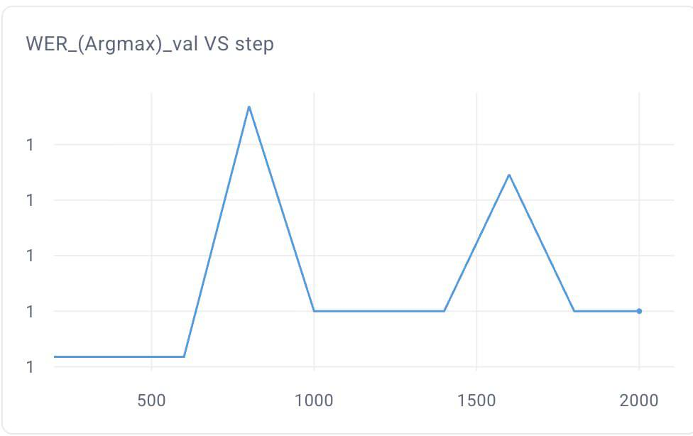
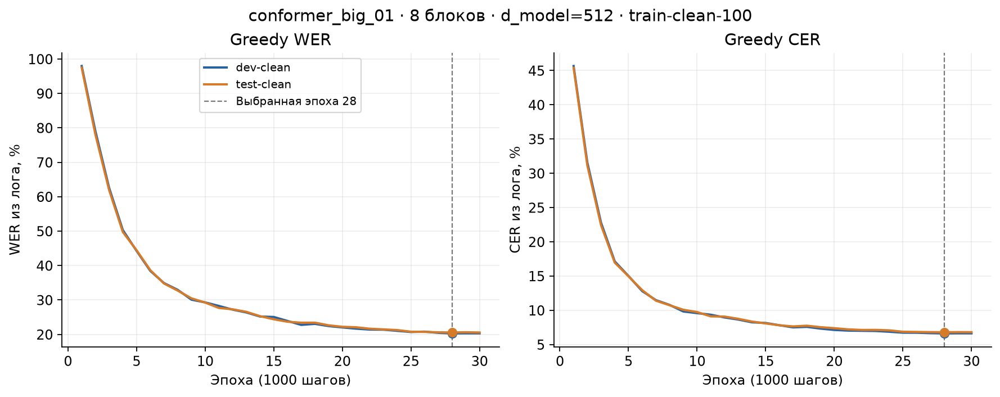
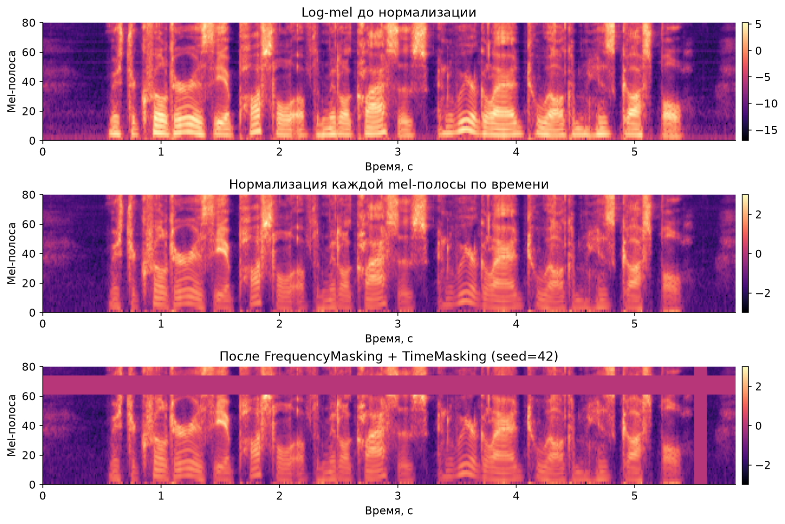
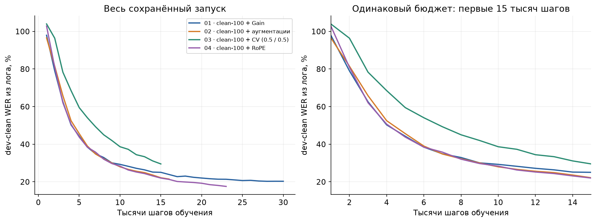
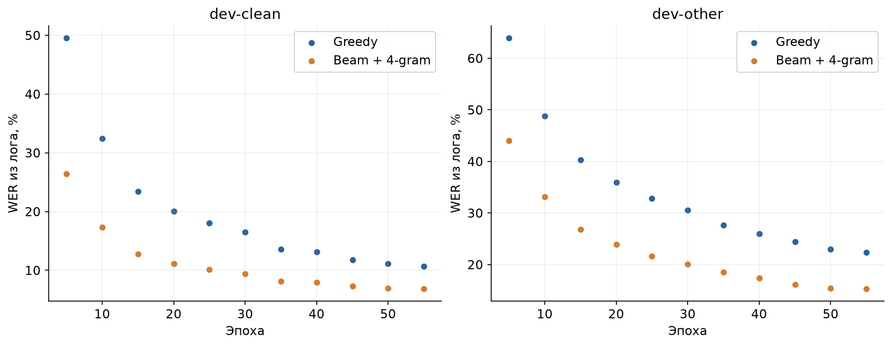
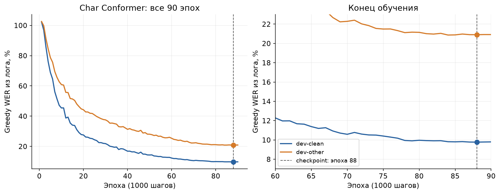
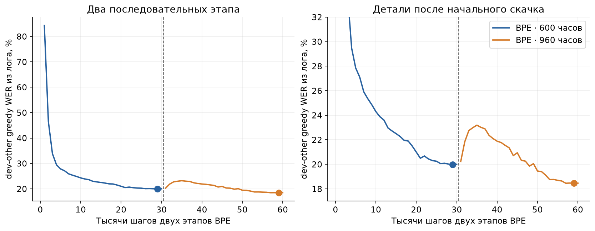
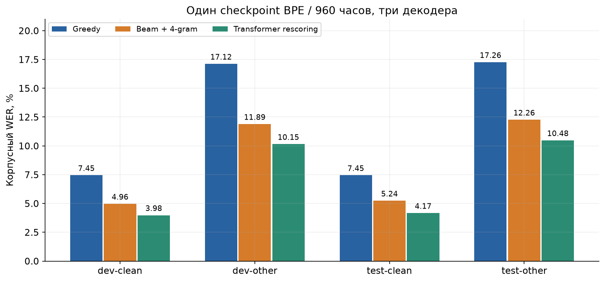

# HW1, ASR. Итоговый отчет.

## Краткий обзор

В качестве ДЗ предлагалось написать и обучить свою ASR модель. Начал с бейзлайна из шаблона, потом собрал Conformer с CTC, добавил аугментации, а также разделил их на аудио и спектрограммные отдельно. После этого долил больше данных, увеличил исходный конформер, прикрутил к нему сверху N-gram модель для оценки и LM рескоринг. Также попробовал долить еще данных. 

Финальная модель - Conformer на 16 блоков с BPE, 4-gram LM и LM рескорингом. Получилось 4.17% WER на test-clean и 10.48% на test-other. Хотел опуститься ниже 10% на other, но немного не хватило. Уверен, что добавление RNN-T дало бы достаточный буст (до 8% WER на test-other), но, к сожалению, не успел(

## До Conformer: проверка пайплайна и baseline

Сначала запускал MLP из шаблона: 128 входных mel-признаков, два скрытых linear-слоя по 512 с ReLU и выход в символьный словарь.

Начал с готового конфига `onebatchtest`, на нем же первое время тестировал новые эксперименты. Метрики на onebatch не привожу отдельно, а вот метрики обучения обучения на бейзлайне с основным конфигом `example` на 100 часах LibriSpeech clean-100:

- [exp_baseline_02](https://www.comet.com/konstantin-stakheev/dla-asr-hw/qqpsbxfus1g22fd0eirgp17d2r7qots5) запустился на clean-100: batch size 10, 200 шагов в эпохе, OneCycle с max LR 0.01. Остановил его примерно на 2000 шагах. Последний dev-clean WER - 100%, CER - 95.22%; training loss на шаге 1950 - 4.63. Test WER тоже был 100%, но его последнее измерение относится к шагу 1800.

Это не значит, что baseline принципиально нельзя обучить: запуск короткий, возможно можно учить его дальше, но я не стал. На этом этапе решил перейти к конформеру, что рекомендуется оригинальным readme с заданием.



*Рисунок 1. [exp_baseline_02](https://www.comet.com/konstantin-stakheev/dla-asr-hw/qqpsbxfus1g22fd0eirgp17d2r7qots5), обучение бейзлайна на clean-100. WER держится около 100%, вставил эту картинку т.к. ось Y очень забавная*

## Первый Conformer

Первый вариант был небольшим и тестовым: 4 блока, d_model=128, 4 attention heads, 128 mel-полос. Перед полным обучением снова проверил onebatch. Во время написания кода полностью руководствовался оригинальной статьей [Gulati et al](https://arxiv.org/pdf/2005.08100). Реализация крайне похожа на авторскую, но так как мы живем в современном мире заменил LayerNorm и BatchNorm на [RMSNorm](https://arxiv.org/pdf/1910.07467), т.к. такой подход активно используется в современных больших трансформерах. Также, в качестве позиционных эмбеддингов, вместо [Sinusoidal Positional Embedding](https://arxiv.org/pdf/1706.03762), использовал [RoPE](https://arxiv.org/pdf/2104.09864), которые также сегодня активнее используются в трансформерах. Полная конфигурация:

- Две Conv2d с ядром 3 и stride 2 уменьшают временную размерность примерно в четыре раза. Затем идёт linear-проекция в `d_model`.
- В каждом блоке: FFN → attention → convolution module → FFN → нормализация. У FFN residual с коэффициентом 0.5, расширение в четыре раза и SiLU.
- В convolution module используются pointwise-свёртки, GLU и depthwise-свёртка с ядром 32.
- В attention добавил RoPE, вычисление attention сделано через SDPA.
- Вместо LayerNorm и BatchNorm использую RMSNorm.
- На выходе - linear в словарь и log-softmax. Обучение через CTC loss.

В [conformer_debug_01](https://www.comet.com/konstantin-stakheev/dla-asr-hw/mqxy8b5cpkuj6jznopzk0uje9k6yo3y2) loss и grad_norm стали `nan`, CER/WER - 100%. После исправлений [conformer_debug_02](https://www.comet.com/konstantin-stakheev/dla-asr-hw/upug52pgrf9cjda26ulaicslib43qj3q) уже дал нулевые CER и WER на шаге 800. Validation loss - 0.00530. То есть модель смогла запомнить маленькую выборку, это был первый небольшой успех. После этого решил запустить более серьезный эксперимент.

[conformer_exp_1](https://www.comet.com/konstantin-stakheev/dla-asr-hw/ezkb3zm8us9zxqjgdyjlhqfeagkm4rf7) обучался на train-clean-100 с batch size 10. Тогда еще учил локально на MacBook M3 Pro, позже переехал на H100. Max LR всё ещё 0.01. На последней эпохе dev-clean WER - 54.47%, test-clean - 53.71%. Такой небольшой Confrormer показал себя как отличный бейзлайн, решил оптимизировать его дальше.

После этого увеличил модель до 8 блоков и d_model=512, снизил max LR до `3e-4` и увеличил число шагов в эпохе до 1000. Изменились сразу половина обучения: размер модели, LR, batch size и кол-во степов, поэтому весь следующий прирост нельзя приписать только размеру модели, но выигрыш получился отличный. В [conformer_big_01](https://www.comet.com/konstantin-stakheev/dla-asr-hw/fnhb4txlqw58c8dkf14ax8bmkfup2qy8) на 28-й эпохе, лучшей по dev-clean WER, получил 20.28% WER и 6.62% CER на dev-clean, 20.54% WER и 6.79% CER на test-clean. Это уже давало больше половины баллов за HW, но результат по прежнему был на dev-clean.



*Рисунок 2. conformer_big_01: WER и CER по эпохам из [сохранённого лога](results/report_runs.json). Пунктиром отмечена выбранная эпоха 28.*

Примерно после этого этапа я решил перейти к аугментациям. Разделил аугментации на аудио- и спектрограммные, накинул первые аугментации - Speed perturbation, Gain и Colored noise для аудио и Frequency и Time маскирование для спектрограмм. Также в экспериментах существенный прирост дал переход к log спекртрограммам, а также нормализация по времени.

По разнообразной нормализации и операциям с аудио: привожу сами wav к 16 кГц, в финальной версии экспериментов использую 80 mel-полос и `log(mel + 1e-9)`. После логарифма нормализую каждую полосу по времени в пределах одной записи: вычитаю среднее и делю на стандартное отклонение. Нормализация выполняется до padding.

Конкретный список использованных аугментаций:

- Speed perturbation с коэффициентами 0.9, 1.0 и 1.1.
- Gain от −6 до +6 dB с вероятностью 0.5.
- Colored noise с SNR 20-30 dB и вероятностью 0.3.
- Frequency masking с `freq_mask_param=15`.
- Time masking с `time_mask_param=30`, `p=0.1`. Здесь `p` ограничивает долю времени под маской, а не вероятность применения аугментации.



*Рисунок 3. Одна запись dev-clean `1272-128104-0000`, обработанная текущими трансформами проекта. Это иллюстрация preprocessing, построенная отдельно для отчёта, а не скриншот обучения из Comet. Wav-аугментации здесь выключены; для SpecAugment зафиксирован seed=42. Нормализованные панели используют одинаковую цветовую шкалу, маски заполняются нулём.*

## Еще эксперименты: LibriSpeech 100 часов и аугментации

Первые основные запуски были на `train-clean-100`: 8 Conformer-блоков, `d_model=512`, batch size 32, до 30 эпох по 1000 шагов, максимальный LR `3e-4`.

Wav-аугментации применяются до вычисления спектрограммы, spectral-аугментации - после получения log-mel. На inference случайные аугментации отключены.

Common Voice добавлял как случайную подвыборку примерно на 300 часов. В этом эксперименте он не помог: на одинаковой dev-clean WER был 22.16% без CV и 29.51% со смесью. При весах 0.5/0.5 половина выборки приходилась на CV, поэтому за то же число шагов модель видела меньше LibriSpeech. Плюс могло повлиять различие данных. Проверки с одинаковым количеством примеров LibriSpeech не было, так что утверждать, что CV вообще бесполезен я не могу. Для следующих запусков оставил LibriSpeech, потом пришла идея долить побольше разных LibriSpeech train выборок.



*Рисунок 4. dev-clean greedy WER из [сохранённых логов](results/report_runs.json), без сглаживания. Слева весь доступный запуск, справа общий бюджет первых 15 тысяч шагов. На 15-й эпохе смесь с CV заметно хуже запуска с аугментациями без CV; отдельного контроля с одинаковым числом примеров LibriSpeech нет.*

По этой таблице нельзя сказать, что аугментации ухудшили качество: второй запуск обучался меньше первого. Аналогично, разницу между 01 и 04 нельзя целиком приписать RoPE. Однако, совокупность изменений явно дает буст. Проблемы появились при доливе Common Voice, но я думаю, что надо было просто подольше поучиться.

## Собственный beam search

Реализовал CTC prefix beam search: для каждого префикса храню две лог-вероятности - завершение на blank и на non-blank. Повторы токенов обрабатываются отдельно, вероятности разных путей складываются через logaddexp. После каждого кадра оставляю лучшие префиксы.

С такой реализацией в [запуске 06](https://www.comet.com/konstantin-stakheev/dla-asr-hw/4xkm8f8moyieszgclogwdczt7exhot6s) получился новый лучший скор всего на 19 эпохе:

| Split | Greedy WER из лога | Собственный beam WER из лога |
| --- | ---: | ---: |
| dev-clean | 19.28 | 19.00 |
| test-clean | 19.73 | 19.38 |

Прирост небольшой, но и учил я недолго. Захотелось завезти дополнителньно n-gram LM оценку.

Еще столкнулся с проблемой - обучение стало ооочень долгим. Позже дорогие декодеры вынес из частых проверок: во время обучения следил прежде всего за greedy, полный декодер запускал отдельно или реже (сначала раз в 5 эпох, потом уже после обучения).

## Больше данных и языковая модель

Следующим шагом добавил `train-other-500`: получилось 600 часов LibriSpeech, веса источников clean-100/other-500 - 1:5. Веса задают вероятность выбрать источник; это не гарантия ровно такого же отношения часов в каждом батче.

* В [08](https://www.comet.com/konstantin-stakheev/dla-asr-hw/lyz8dpwlk5jv4tmtumqosi7edv2zn6bj) 20 эпох: на последней dev-other greedy WER был 36.85%, с собственным beam - 36.09%. Это ещё промежуточная модель, а не итог добавления other-500.

* В [09](https://www.comet.com/konstantin-stakheev/dla-asr-hw/37fkk9sstsm9pkye2rm8fx4d0rjin0o9) подключал LM-декодирование. В сохранённом training-логе 32 полные эпохи; лучшая по dev-clean greedy - 31-я, с WER 15.43%. Отдельной сопоставимой оценки влияния только LM по этому логу не делаю. Следующий [10](https://www.comet.com/konstantin-stakheev/dla-asr-hw/mcz96ugvivu6ahzowoifv1vylhr7nf5a) остановился из-за OOM до завершения первой эпохи, уменьшил батч. Сравнение с 4-gram уже есть с запуска 11.

Также перешёл с 128 на 80 mel-полос и добавил нормализацию признаков.

LM дала намного более заметный прирост, чем beam без LM (как и обещали в описании задачи). Например, на одной и той же 55-й эпохе [запуска 11](https://www.comet.com/konstantin-stakheev/dla-asr-hw/w61j64qc8g0f6opz85pjdj8t1lrqj84a):

| Split | Greedy WER из лога | Beam + 4-gram WER из лога |
| --- | ---: | ---: |
| dev-clean | 10.68 | 6.87 |
| dev-other | 22.39 | 15.32 |
| test-clean | 10.81 | 7.06 |
| test-other | 24.03 | 16.77 |

Для LM-декодирования начиная с этого момента использую `pyctcdecode` и готовую LibriSpeech 4-gram LM. Собственный beam без LM при этом остаётся отдельным вариантом декодирования.



*Рисунок 5. [Запуск 11](https://www.comet.com/konstantin-stakheev/dla-asr-hw/w61j64qc8g0f6opz85pjdj8t1lrqj84a), значения из [info.log](results/report_runs.json). Только эпохи, на которых есть оба декодера; отсутствующие измерения не дорисованы. WER из лога, не корпусный.*

Исходный [график BeamLM на dev-other из Comet](assets/report/lm_dev_other_comet.png) тоже сохранил. Там WER в долях, а по X идут шаги.

## Увеличение модели и еще больше обучения

После этого решил еще увеличить конформер: поставил 16 блоков, оставил d_model=512 и 8 attention heads. Заодно поднял бюджет до 90 эпох по 1000 шагов. Batch size пришлось уменьшить до 16, т.к. на длинных записях память H100 уже заканчивалась. На этом этапе учил с нуля на clean-100 и other-500, всего 600 часов.

Дальше попробовал перейти с символов на BPE, а потом долил train-clean-360. Чтобы не потеряться в том, что откуда дообучалось, собрал все три этапа в таблицу:

| Этап | Данные | Инициализация | Эпохи × шаги | Batch | Max LR / warmup | Выбранный checkpoint |
| --- | --- | --- | --- | ---: | --- | --- |
| [Char, 16 блоков](https://www.comet.com/konstantin-stakheev/dla-asr-hw/of2rs4kdm1e064kvrv2y9p52j1x30rtr) | clean-100 + other-500 | С нуля | 90 × 1000 | 16 | `3e-4` / 6% | Эпоха 88, минимум greedy WER на dev-clean |
| [BPE, 600 часов](https://www.comet.com/konstantin-stakheev/dla-asr-hw/hpk3bgbxoxfv3h55loph17qwdh908oog) | clean-100 + other-500 | Энкодер от char, новая CTC-голова | 30 × 1000 | 16 | `1e-4` / 10% | Эпоха 29, минимум greedy WER на dev-other |
| [BPE, 960 часов](https://www.comet.com/konstantin-stakheev/dla-asr-hw/k514yjd81hafadiwj9jx0qq1wvepn96j) | clean-100 + clean-360 + other-500 | Полная BPE-модель предыдущего этапа | 30 × 1000 | 16 | `1e-4` / 10% | Эпоха 29, минимум greedy WER на dev-other |

В финале получилось 460 часов clean и 500 часов other. Common Voice сюда уже не добавлял. Веса clean-100, clean-360 и other-500 задал как 1:3.6:5. Подбирал их больше на рандом на самом деле, но старался примерно как относительные размеры датасетов.



*Рисунок 6. Обучение 16-блочного конформера на символах. Справа приблизил последние эпохи, т.к. там изменения уже небольшие. Выбрал чекпоинт 88-й эпохи по dev-clean WER. Значения из [логов](results/report_runs.json), исходный [график dev-other из Comet](assets/report/char90_dev_other_comet.png) тоже приложил.*

## Переход на BPE

Следующей идеей было заменить символы на BPE. Обучил свой токенизатор через SentencePiece на транскрипциях train-clean-100 и train-other-500. Взял словарь на 1024 токена, добавил отдельный CTC blank, получилось 1025 выходов модели.

Dev и test для обучения токенизатора не использовал. Когда потом долил clean-360, BPE оставил прежним. Информация о корпусе и его hash лежит в [метаданных токенизатора](tokenizers/librispeech_bpe_1024.json).

Чтобы не обучать всю модель с нуля еще раз, взял энкодер от символьного конформера и заменил CTC-голову на новую. Поучил еще 30 эпох с max LR `1e-4`. Сам по себе BPE ожидаемого буста не дал: с полным декодером получилось даже немного хуже, чем на символах. Ниже уже корпусный WER после LM рескоринга:

| Модель | dev-clean | dev-other | test-clean | test-other |
| --- | ---: | ---: | ---: | ---: |
| Char, 600 часов | 4.19 | 10.74 | 4.24 | 11.15 |
| BPE, 600 часов | 4.42 | 11.02 | 4.61 | 11.40 |
| BPE, 960 часов | 3.98 | 10.15 | 4.17 | 10.48 |

После этого решил долить оставшиеся 360 часов clean и продолжил обучение BPE-модели еще на 30 эпох. Это помогло: test-other упал с 11.40% до 10.48%. Правда вместе сданными добавилось еще 30 тысяч степов, поэтому сколько здесь дали сами данные, а сколько дополнительное обучение - отдельно не проверял. Но кажется, что прошлые запуски выходили на плато, поэтому дело скорее в данных.



*Рисунок 7. Два запуска BPE подряд: сначала 600 часов, потом 960. По X суммарное кол-во шагов этих двух этапов, точки - выбранные чекпоинты на 29-й эпохе каждого запуска. Справа приблизил график после начального скачка. Значения из [логов](results/report_runs.json). В исходном [Comet-графике второго запуска](assets/report/bpe960_dev_other_comet.png) шаги начинаются заново.*

## Подбор параметров LM и N-best рескоринг

Еще до BPE решил попробовать выжать побольше из декодера. Взял символьный чекпоинт 88-й эпохи и стал подбирать параметры 4-gram на dev-other. Саму сеть на этом этапе не трогал.

| Параметр | Исходный вариант | Выбранный вариант |
| --- | ---: | ---: |
| `alpha` | 0.5 | 0.8 |
| `beta` | 1.0 | 1.0 |
| `beam_width` | 50 | 1000 |
| `beam_prune_logp` | −10 | −12 |
| `token_min_logp` | −5 | −7 |

Получилось снизить dev-other WER с 13.31% до 12.37%, а test-other - с 13.56% до 12.67%. Параметры подбирал только на dev-other, на test запускал уже выбранный вариант.

После этого добавил N-best рескоринг. Идея простая: beam с 4-gram выдает до 100 гипотез, затем более сильная текстовая LM оценивает каждую из них. Смешиваю ее скоры с акустическим и поправкой на длину, выбираю лучший текст.

Взял готовую LM из [SpeechBrain](https://huggingface.co/speechbrain/asr-transformer-transformerlm-librispeech). Саму LM не дообучал.

Для BPE на dev-other подобрал `neural_weight=0.8`, `ngram_weight=0.0`, `word_bonus=1.25`. Итоговый скор выглядит так:

```text
score = acoustic_logp + 0.8 * neural_logp + 1.25 * word_count
```

То есть на втором проходе n-gram score уже не добавляю, но сама 4-gram все еще нужна, т.к. с ней строится исходный список гипотез. Для финальной модели на 960 часах оставил эти же коэффициенты, заново их не подбирал.

На символьной модели рескоринг снизил test-other WER с 12.73% до 11.15%.



*Рисунок 8. Финальная BPE-модель на 960 часах с тремя вариантами декодирования. Чекпоинт везде один, меняется только декодер. Числа взял из [сохраненных результатов](results/decoder_comparison.json), ниже они же в таблице.*

## Финальные результаты

Для финальной оценки взял `conformer_bpe1024_960h_01/model_best.pth`, это 29-я эпоха последнего запуска. Посчитал greedy, beam с 4-gram и LM рескоринг на одном чекпоинте. У beam ширина 1000, сохраняю до 100 гипотез.

Здесь WER и CER считаю по всему корпусу: суммирую ошибки и делю на общее кол-во слов или символов.

| Split | Записей | Greedy WER | 4-gram WER | Rescore WER | Rescore CER |
| --- | ---: | ---: | ---: | ---: | ---: |
| dev-clean | 2703 | 7.45 | 4.96 | 3.98 | 1.68 |
| dev-other | 2864 | 17.12 | 11.89 | 10.15 | 5.84 |
| test-clean | 2620 | 7.45 | 5.24 | 4.17 | 1.71 |
| test-other | 2939 | 17.26 | 12.26 | 10.48 | 5.81 |

До желаемых 10% немного не дотянул, но декодер дал очень хороший буст без изменения самой сети. Это круто)

### Примеры распознавания

Выбрал несколько записей из dev-other, чтобы показать, что именно меняется после LM. Есть и удачные исправления, и ошибки. Это примеры, выбранные вручную, общие метрики считаются по всем записям. Тексты не правил, [исходные предсказания](results/report_examples.json) тоже сохранил.

`5849-50873-0028`

| Вариант | Текст |
| --- | --- |
| Reference | boy have a care how you approach me |
| Greedy | boys have a care how youroached me |
| 4-gram | boys have a care how you approach me |
| Rescoring | boy have a care how you approach me |

Тут помогли оба прохода: 4-gram восстановила `you approach`, а рескоринг еще исправил `boys` на `boy`.

`7697-105817-0005`

| Вариант | Текст |
| --- | --- |
| Reference | so they set off through the field |
| Greedy | so they sat off through the field |
| 4-gram | so they set off through the field |
| Rescoring | so they set off through the field |

Здесь хватило одной 4-gram: исправила `sat` на `set`, рескоринг оставил тот же текст.

`4831-29134-0015`

| Вариант | Текст |
| --- | --- |
| Reference | it was senator of the united states |
| Greedy | it was sentnditor of the united states |
| 4-gram | it was senator of the united states |
| Rescoring | it was a senator of the united states |

А тут рескоринг сделал хуже: после 4-gram текст уже был правильным, но Transformer LM добавила лишний артикль `a`.

`4831-25894-0017`

| Вариант | Текст |
| --- | --- |
| Reference | how gay the streets were that day |
| Greedy | how gave the streets where that day |
| 4-gram | how gave the streets where that day |
| Rescoring | how gave the streets where that day |

Здесь вообще ничего не помогло. `gave` вместо `gay` и `where` вместо `were` остались после обоих вариантов LM.

## С чем возникли проблемы

Первая проблема была еще на маленьком конформере: loss уходил в `inf`, потом в `nan`. Долго думал в чем проблема, оказалось что после сабсемплинга кадров должно хватать для CTC-выравнивания с текстом, я об этом сначаа совсем не думал. Причем еще надо учитывать повторяющиеся токены. С этим пришлось разобраться. Помогло просто подвигать параметры.

Потом начались OOM, причем уже на H100, а не на маке. Большая модель и длинные записи быстро съедали память, поэтому для большой модели из 16 блоков уменьшил batch size до 16.

Еще много времени уходило на beam search. Когда включил его на каждой валидации, ждать пришлось заметно дольше. В итоге во время обучения в основном смотрел greedy на dev-clean и dev-other, а дорогие декодеры гонял отдельно на выбранном чекпоинте или считал реже. Потом вообще их отключил и считал уже только после обучения.

Ну и были стандартные проблемы с зависимостями torchaudio, torchao и т.п.

## Что в итоге помогло

Самый понятный буст дали LM и рескоринг. Тут можно взять один чекпоинт и сразу сравнить декодеры, не меняя остальную модель. Долив clean-360 вместе с продолжением обучения тоже сильно улучшил результат.

А вот Common Voice в раннем запуске и BPE на тех же 600 часах ожидаемого улучшения не дали (хотя на BPE возлагал большие надежды, так и не понял почему нет буста). С CV я бы еще попробовал другие веса и подольше поучился, но в этой работе дальше использовал только LibriSpeech. BPE оставил и уже с ним дообучился на 960 часах т.к. и сильно хуже он не делал.

Если продолжать эксперименты, я бы сначала сравнил дополнительное обучение на 600 и 960 часах с одинаковым кол-вом степов. Так можно понять, насколько помогли сами новые данные. Еще можно посмотреть, как часто правильный текст уже есть среди N-best, но рескоринг выбирает другую гипотезу. Все это подбирал бы на dev-other, test оставил бы для итоговой проверки. НУ и добавил бы RNN-T, думаю с ним получится выбить уже реально крутое качество. Текущий декодер все же не очень))

## Все запуски

Всего в Comet сохранилось 23 запуска, включая onebatch и неудачные старты. Оставил ссылки на все, чтобы можно было посмотреть историю экспериментов. Не каждый запуск здесь проверяет одно конкретное изменение, иногда менял сразу несколько вещей.

`Crashed` в Comet не всегда означает ошибку: часть запусков я просто останавливал вручную. Кол-во полных эпох для поздних экспериментов взял из `info.log`, т.к. `Current step` в интерфейсе иногда отставал.

| № | Запуск | Что было и чем закончился |
| ---: | --- | --- |
| 1 | [onebatch_07](https://comet.com/konstantin-stakheev/dla-asr-hw/5l0qstrmy0hsnqyhv7rt1d71861qxnfk) | Baseline на двух записях; KeyboardInterrupt до первой завершённой эпохи. |
| 2 | [onebatch_08](https://comet.com/konstantin-stakheev/dla-asr-hw/byzkho4f032hrl1wll0851xwjb6szfhy) | Baseline на двух записях, 50 эпох / 10 000 шагов. Последний WER 20.40%, CER 6.44%; это onebatch, не оценка на полном dev-clean. |
| 3 | [exp_baseline_01](https://comet.com/konstantin-stakheev/dla-asr-hw/v0lg1scf0oejf0e6xhach0j49s1qmqx4) | Загрузка train-clean-100 завершилась SSLEOFError; метрик обучения нет. |
| 4 | [exp_baseline_02](https://comet.com/konstantin-stakheev/dla-asr-hw/qqpsbxfus1g22fd0eirgp17d2r7qots5) | Baseline на clean-100, остановлен вручную. Последний dev WER 100% на шаге 2000; test WER 100% на шаге 1800. |
| 5 | [conformer_debug_01](https://comet.com/konstantin-stakheev/dla-asr-hw/mqxy8b5cpkuj6jznopzk0uje9k6yo3y2) | Onebatch Conformer: loss и grad_norm стали nan, WER/CER 100%; остановлен вручную. |
| 6 | [conformer_debug_02](https://comet.com/konstantin-stakheev/dla-asr-hw/upug52pgrf9cjda26ulaicslib43qj3q) | Onebatch Conformer: WER/CER 0% на шаге 800; train loss 0.00570845 на шаге 950. Полное обучение не завершено. |
| 7 | [conformer_exp_1](https://comet.com/konstantin-stakheev/dla-asr-hw/ezkb3zm8us9zxqjgdyjlhqfeagkm4rf7) | 4 блока, d_model=128, 4 головы. 50 эпох по 200 шагов; последние dev/test WER 54.47% / 53.71%. |
| 8 | [conformer_big_01](https://comet.com/konstantin-stakheev/dla-asr-hw/fnhb4txlqw58c8dkf14ax8bmkfup2qy8) | 8 блоков, d_model=512, clean-100. Завершены 30 эпох; выбранная эпоха 28. |
| 9 | [conformer_big_02_with_augs](https://comet.com/konstantin-stakheev/dla-asr-hw/b2sbj2ke1yy6keovu9eslo19nwjiuudw) | Расширенные wav/spec-аугментации. В логе 16 завершённых эпох. |
| 10 | [conformer_big_03_two_datasets](https://comet.com/konstantin-stakheev/dla-asr-hw/pffsae5qg50x1m8vw90ln2ovnedtip7c) | clean-100 + около 300 часов CV, веса 0.5/0.5. 15 завершённых эпох; KeyboardInterrupt. |
| 11 | [conformer_big_04_two_datasets_and_rope](https://comet.com/konstantin-stakheev/dla-asr-hw/ymx0ovqgzejuv048l11e2ql1v42ovyaw) | Попытка подключить RoPE. Ошибка импорта модели до обучения. |
| 12 | [conformer_big_04_two_datasets_and_rope_v2](https://comet.com/konstantin-stakheev/dla-asr-hw/era2s18z34kdtw86hu3bw3av8npnebkh) | Повторный запуск смеси с RoPE. OOM, остановка до первой завершённой эпохи. |
| 13 | [conformer_big_04_rope_v2](https://comet.com/konstantin-stakheev/dla-asr-hw/7nqwj1bdiaxoktii107c8ogltijwijzd) | RoPE, только clean-100. В логе 23 завершённые эпохи. |
| 14 | [conformer_big_05_beam_search](https://comet.com/konstantin-stakheev/dla-asr-hw/bwrlyv94yn9rq7eeascolfv4c0azf2mv) | Первое включение собственного beam. Одна завершённая эпоха; KeyboardInterrupt. |
| 15 | [conformer_big_06_beam_search_faster](https://comet.com/konstantin-stakheev/dla-asr-hw/4xkm8f8moyieszgclogwdczt7exhot6s) | Оптимизация собственного beam. В логе 19 завершённых эпох. |
| 16 | [conformer_big_07_libri600h](https://comet.com/konstantin-stakheev/dla-asr-hw/s6o4obi9yvmsbm6f4fi7z8etmd0d0ihx) | Добавлен other-500. Четыре завершённые эпохи; KeyboardInterrupt. |
| 17 | [conformer_big_08_libri600h_faster](https://comet.com/konstantin-stakheev/dla-asr-hw/lyz8dpwlk5jv4tmtumqosi7edv2zn6bj) | Следующий запуск на 600 часах. 20 завершённых эпох; KeyboardInterrupt. |
| 18 | [conformer_big_09_lm_decoding](https://comet.com/konstantin-stakheev/dla-asr-hw/37fkk9sstsm9pkye2rm8fx4d0rjin0o9) | Этап подключения LM, 600 часов. 32 завершённые эпохи; лучшая по dev-clean greedy - 31. |
| 19 | [conformer_big_10_lm_decoding_4_gram](https://comet.com/konstantin-stakheev/dla-asr-hw/mcz96ugvivu6ahzowoifv1vylhr7nf5a) | 80 mel-полос, попытка запуска с 4-gram. OOM, KeyboardInterrupt до первой завершённой эпохи. |
| 20 | [conformer_big_11_lm_decoding_4_gram](https://comet.com/konstantin-stakheev/dla-asr-hw/w61j64qc8g0f6opz85pjdj8t1lrqj84a) | 8 блоков, 600 часов, 4-gram. 55 завершённых эпох; KeyboardInterrupt. |
| 21 | [conformer_16blocks_90ep_01](https://comet.com/konstantin-stakheev/dla-asr-hw/of2rs4kdm1e064kvrv2y9p52j1x30rtr) | 16 блоков, char-CTC, 600 часов. Завершены 90 эпох; выбранная эпоха 88. |
| 22 | [conformer_bpe1024_01](https://comet.com/konstantin-stakheev/dla-asr-hw/hpk3bgbxoxfv3h55loph17qwdh908oog) | Перенос энкодера в BPE, 600 часов. Завершены 30 эпох; выбранная эпоха 29. |
| 23 | [conformer_bpe1024_960h_01](https://comet.com/konstantin-stakheev/dla-asr-hw/k514yjd81hafadiwj9jx0qq1wvepn96j) | Продолжение BPE на 960 часах. Завершены 30 эпох; выбранная эпоха 29. |

Еще были самые первые offline-запуски, пока разбирался с окружением. В этом списке их нет, метрики для них не восстанавливал.

## Как воспроизвести

Все команды установки, обучения и инференса собрал в [README.md](README.md). Для запуска на своей папке там же есть расчет WER/CER. Можно воспользоваться [демо-ноутбуком](demo.ipynb), веса финальной модели и BPE-токенизатор залил на [Hugging Face](https://huggingface.co/Ryuk1245/dla-asr-hw).

Картинки сохранил в репозиторий, поэтому для чтения отчета логиниться в Comet не нужно. Под графиками указал, откуда взяты числа, отдельно оставил [список источников](results/report_figures.json).
